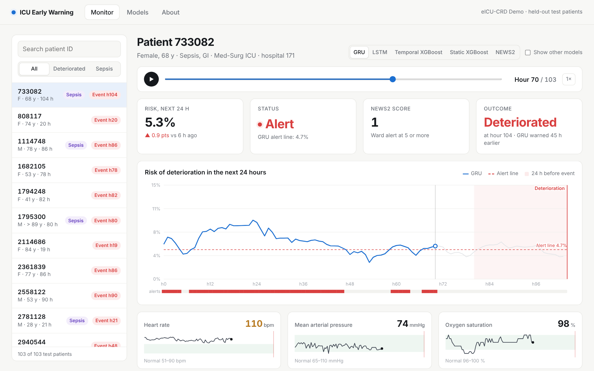

# ICU Deterioration Early Warning

Every hour, estimate the chance that an ICU patient will **deteriorate in the next 24 hours** (start vasopressors, start invasive mechanical ventilation, or die in the ICU), using how their vital signs and labs have changed over the last few hours.

The project tests one idea: *recent trends warn earlier than a single snapshot.* It compares the NEWS2 bedside score with gradient-boosted trees and recurrent neural networks on the same patients from the open [eICU-CRD Demo](https://physionet.org/content/eicu-crd-demo/2.0.1/).



## Try the demo

Open **`demo/index.html`** in any browser. It is a single self-contained page, with no install and no server needed.

- **Monitor:** pick any of the 103 held-out test patients, press <kbd>Space</kbd> to replay their stay hour by hour, and watch the vitals, the NEWS2 score and each model's 24-hour risk against its alert line.
- **Models:** discrimination with 95% CIs, false alarms at equal sensitivity, patients warned, median warning time, and top SHAP features.
- **About:** the problem, the idea and the pipeline.

To host it, enable GitHub Pages for this repository (deploy from the main branch, root folder) and open `/demo/`.

## Results

Held-out test set: 103 ICU stays, 13 of which deteriorated (9,802 patient-hours).

| Model | Input | AUROC (95% CI) | AUPRC (95% CI) | False alarms / patient-day* |
| --- | --- | --- | --- | --- |
| NEWS2 (alert at ≥ 5) | current hour | 0.680 (0.55–0.80) | 0.066 (0.03–0.15) | 3.17 |
| Static XGBoost | current hour, 14 features | 0.665 (0.56–0.79) | 0.089 (0.02–0.26) | 5.20 |
| Temporal XGBoost | 6 h trend features, 98 features | 0.686 (0.56–0.80) | 0.096 (0.03–0.28) | 4.52 |
| LSTM | raw hourly history, 48 h | 0.720 (0.58–0.84) | **0.123** (0.03–0.29) | 3.28 |
| GRU | raw hourly history, 6 h | **0.760** (0.66–0.86) | 0.119 (0.03–0.29) | **3.11** |

\*Each model's threshold is set so it flags the same 34% of pre-event hours as NEWS2 ≥ 5.

History-based models scored best, but with 13 events the confidence intervals overlap and no pairwise difference is statistically significant (patient-level paired bootstrap). The results support the hypothesis without proving it.

## Method

1. **Cohort.** Adults, first ICU stay, length of stay ≥ 48 h, no event in the first 6 h: 684 stays (90 deteriorating) from 2,520 stays across 186 hospitals.
2. **Hourly alignment.** Physiologically impossible values are clipped and readings are binned to hourly medians. Gaps are forward-filled for up to 4 h (vitals) or 24 h (labs), and anything still missing gets an explicit missingness flag.
3. **Labels.** An hour is positive if the first event occurs within the next 24 h. Hours at or after the event are removed.
4. **Features.** For 12 vitals and labs, 6-hour rolling mean, std, min, max, slope and change, plus current values and missingness flags.
5. **Splits.** 70/15/15 by patient (478 / 103 / 103), seed 42.
6. **Models.** NEWS2, Static and Temporal XGBoost (Optuna-tuned on validation AUPRC), and regularised LSTM/GRU seed ensembles with look-back windows from 6 to 72 h. Probabilities are Platt-recalibrated on validation.
7. **Evaluation.** Patient-cluster bootstrap CIs, paired bootstrap tests, lead time within 48 h before the event, false alarms at equal sensitivity, and TreeSHAP.

## Reproduce

1. **Data.** Download the [eICU-CRD Demo v2.0.1](https://physionet.org/content/eicu-crd-demo/2.0.1/) (open access). Unzip these tables into `data/raw/`: `patient.csv`, `vitalPeriodic.csv`, `vitalAperiodic.csv`, `lab.csv`, `infusionDrug.csv`, `respiratoryCare.csv`, `diagnosis.csv`.
2. **Environment** (Python 3.10+):

   ```bash
   pip install -r requirements.txt
   pytest -q
   ```

3. **Pipeline** (`RANDOM_SEED = 42`):

   ```bash
   # Cohort, hourly alignment, labels, features, frozen splits
   python -m src.data_engineering.extract_cohort
   python -m src.data_engineering.temporal_alignment
   python -m src.evaluation.outcome_labels
   python -m src.data_engineering.feature_engineering
   python -m src.data_engineering.build_splits

   # Tree models and baselines
   python -m src.models.train --stage sanity
   python -m src.models.train --stage train
   python -m src.baselines.xgboost_static
   python -m src.baselines.compare --stage all

   # Sequence models (about 1.5 h on 2 CPU cores)
   python -m src.models.run_sequence_experiments

   # Explainability, lead time, calibration, unified evaluation, checks
   python -m src.models.train --stage shap
   python -m src.evaluation.visualize
   python -m src.evaluation.calibrate
   python -m src.evaluation.evaluate_all_models
   python -m src.data_engineering.eda_and_profile
   python -m src.data_engineering.verify_reproducibility

   # Rebuild the demo page from the new results
   python -m src.app.build_demo
   ```

Summary results from the reference run are in `results/`. Figures, trained models and intermediate data are regenerated by the pipeline and are not tracked.

## Repository layout

```
demo/       index.html (self-contained demo) and template.html (its source)
src/        data_engineering/, evaluation/, baselines/, models/, app/ (demo builder)
tests/      unit tests (NEWS2, labels, features, splits, metrics, lead time, sequence models)
results/    summary metrics (CSV/JSON)
docs/       screenshot
```

## Limitations

- The test set is small (13 events), so the confidence intervals are wide.
- The split is random by patient, not by hospital, so performance at unseen hospitals is untested.
- NEWS2 omits consciousness level and supplemental oxygen.
- Event times reflect clinician decisions, which introduces treatment confounding.
- This is a research prototype on retrospective data and is **not for clinical use**.

## Data and attribution

The eICU-CRD Demo is made available by PhysioNet under the [Open Data Commons Open Database License v1.0](https://opendatacommons.org/licenses/odbl/1-0/). `demo/index.html` embeds hourly values derived from it for the 103 test stays. That derived data remains under ODbL v1.0.

- Johnson, A., Pollard, T., Badawi, O., & Raffa, J. (2021). *eICU Collaborative Research Database Demo* (version 2.0.1). PhysioNet. https://doi.org/10.13026/4mxk-na84
- Pollard, T. J., Johnson, A. E. W., Raffa, J. D., Celi, L. A., Mark, R. G., & Badawi, O. (2018). The eICU Collaborative Research Database, a freely available multi-center database for critical care research. *Scientific Data*, 5, 180178.
